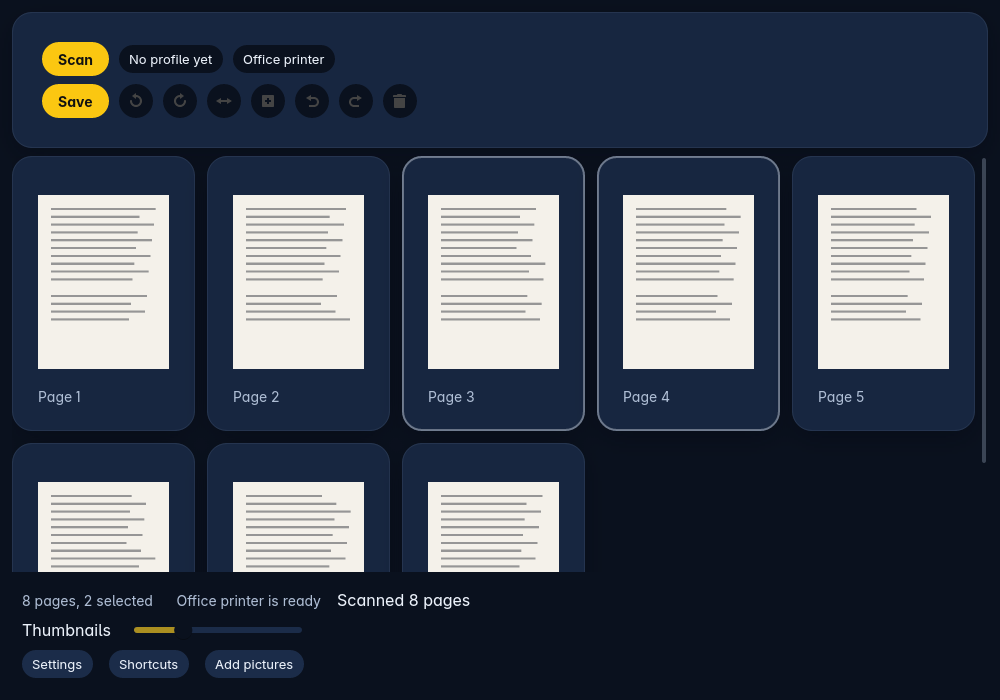
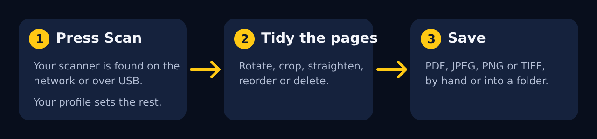
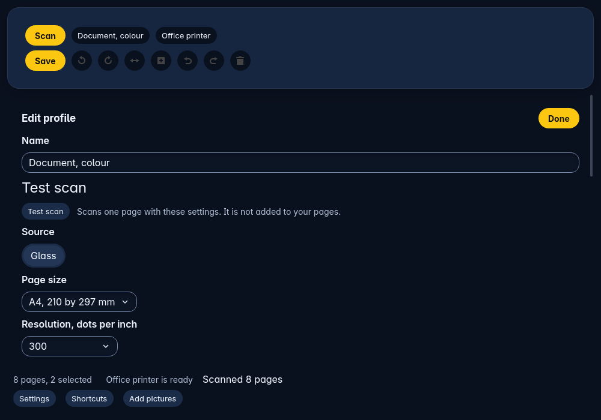
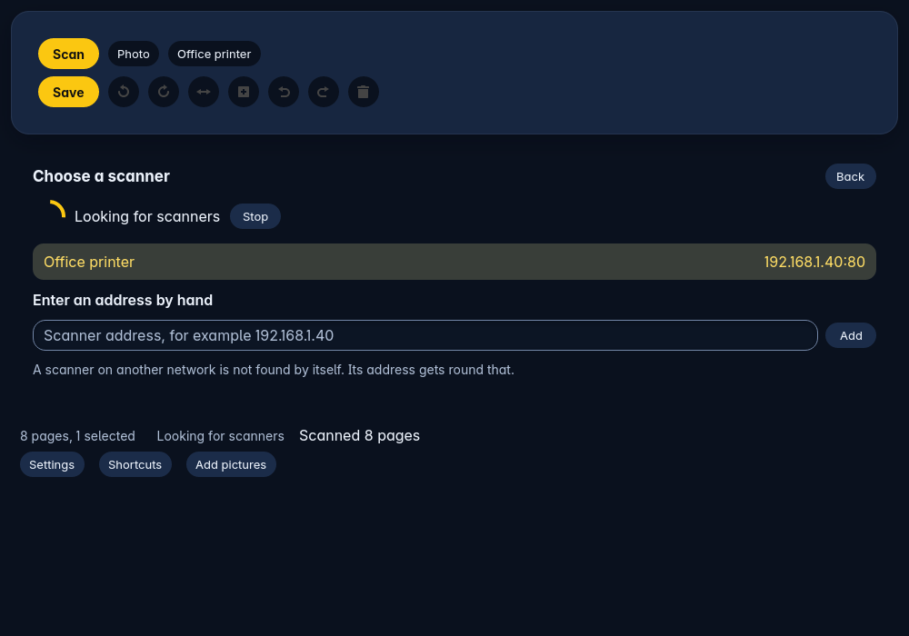
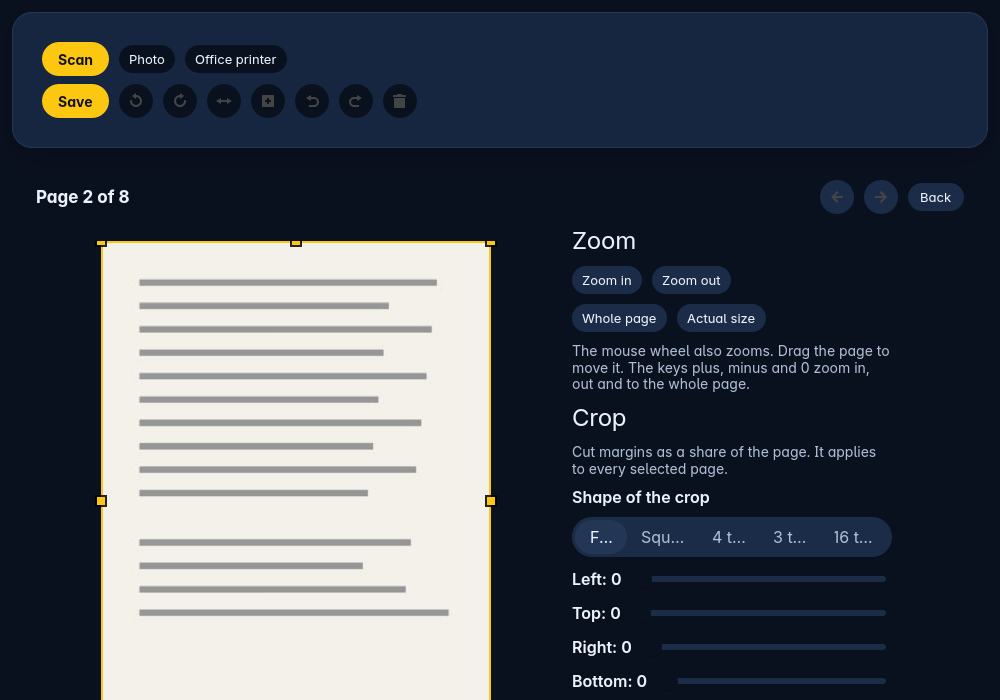
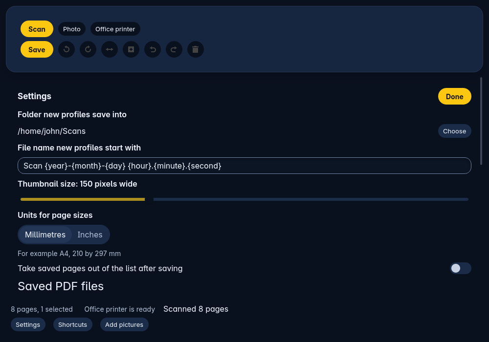

<p align="center"></p>

<p align="center">


</p>

Trindle Scan is a scanning program for Trindle, written in Rust on the Trindle toolkit. You put paper on a scanner, press Scan, and get a tidy file.

It finds network scanners by itself (the driverless kind, called eSCL or AirScan) and USB scanners through SANE, each listed once. You tidy the pages, then save them as PDF, JPEG, PNG or TIFF, or let it save into a folder as each scan finishes. It is installed from Trindle's Apps and is not there by default.

The full guide, with every setting and what to do when something goes wrong, is in [docs/HELP.md](docs/HELP.md).

<p align="center"></p>

## How it works

<p align="center"></p>

## Quick start

Install Trindle Scan from Apps in Trindle. It asks for three things: your home network (to find scanners), your files (to save into), and USB devices (for USB scanners).

Scanners are searched for only after you open the program, and only on your own network. Press Scan. If you have no profile yet, you are asked to make one first, and the scan starts as soon as it is saved.

If your scanner is on another network segment and is not found, type its address in the **Scanner address** box in the scanner list.

## Profiles and the scanner

A profile is a named bundle: scanner, source (glass, feeder, both sides), page size, resolution, colour mode, brightness, contrast, and what happens after the scan. One profile is the default, and the big Scan button uses the current one. Each setting shows only what your scanner reports it can do.

<table>
<tr>
<td align="center"><br><b>Profile editor</b></td>
<td align="center"><br><b>Finding scanners</b></td>
</tr>
</table>

## Tidying pages

Rotate, flip, crop, delete, undo and redo work on the selected pages. The large view zooms with the mouse wheel, pans by dragging, and crops with a box you pull by its handles, or to a held shape (free, square, 4:3, 3:2, 16:9). Pages can be straightened, trimmed, and corrected for brightness and contrast. Blank pages can be skipped as they arrive.

<table>
<tr>
<td align="center"><br><b>Zoom and crop</b></td>
<td align="center"><br><b>Settings</b></td>
</tr>
</table>

## What it does

- Finds network scanners (eSCL) and USB scanners (SANE), shown once each, with a way to enter an address by hand.
- Scans from the glass, a feeder, both sides in one pass, or manual two-sided for feeders that cannot do both.
- Batch scanning with a pause between stacks.
- Saves PDF, JPEG, PNG and multi-page TIFF, with PDF title, author, subject, keywords, an optional password, and splitting every N pages.
- Searchable PDF by text recognition (Tesseract, carried in the plugin).
- Auto-save into a folder with a naming pattern and counter.
- Opens pictures to add to the page list.
- Works from the keyboard, with names on controls for screen readers.

## Scanners that are tested and not tested

Tested with real hardware: none of the network scanners yet; the Epson ET-2710 on a USB cable (below). The program is tested against a simulated scanner, and its network and USB code is covered by automatic tests.

The Epson ET-2710 on USB shows up in the list as "Epson L3150 Series", which is the name the Linux scanner software gives it.

- On 26 October 2026 it did one or two scans in a row and then stopped responding until it was switched off and on. The cause looked like the printer being contacted in the seconds after a scan, so the program now leaves a USB scanner alone for five seconds after each scan.
- On 27 October 2026, after the printer was switched off and on, four scans in a row all worked and the printer was still listed afterwards. That is one run, so longer use on this printer is not yet proved.
- The better route for this printer is `ipp-usb`, which shares it as a driverless network scanner. The program lists such a scanner, but that route has not been tried with this printer.

If your scanner does not appear, say so in a bug report with its make and model. Which driver packages the Trindle image carries is in [docs/scanner-drivers.md](docs/scanner-drivers.md).

## Settings

Settings are changed in the program's own Settings screen and saved as you change them. There are no environment variables or config files to edit.

| Setting | Required | Default | What it does |
|---|---|---|---|
| Default folder for new profiles | no | none | Where a new profile's auto-save goes. |
| Default file name for new profiles | no | a built-in pattern | The naming pattern a new profile starts with. |
| Temporary pages folder | no | `$XDG_RUNTIME_DIR`, else the system temporary folder | Where pages are copied as they are scanned (see below). Used the next time the program starts. |
| Units for page sizes | no | millimetres | Millimetres or inches. |
| Remove pages from the list once saved | no | off | Takes saved pages out of the list. |
| PDF title, author, subject, keywords | no | empty | Written into saved PDF files. |
| Pages in each PDF file | no | all | Splits a long scan into several files. |
| Password to open the PDF | no | none | Stored as plain text in the settings file, so for casual privacy only. |
| Thumbnail size | no | 150 pixels wide | Slider in the page list. |

## Where your data lives

Settings and profiles are plain files (`settings.conf` and `profiles.conf`) under `~/.config/trindle-scan/`. Scanned pages are held in memory while you work, and each one is also copied to a recovery folder, `trindle-scan-pages`, so a crash does not lose them. It is inside `$XDG_RUNTIME_DIR` (or the system temporary folder), or inside the folder you set in Settings. The folder is made readable by you only (mode 0700) and its files are 0600. It is emptied on a normal exit, or when you discard recovered pages; after a crash the pages stay until you recover or discard them. Pages are otherwise written only where you save them. Nothing is sent over the internet.

## Security

Scanners are looked for on the local network only, and only after you open the program. The plugin asks for the home network, files and USB devices, and nothing else. See [SECURITY.md](SECURITY.md) for how to report a problem.

## Building it yourself

Trindle Scan builds with Rust. It takes the Trindle toolkit from its GitHub repository, pinned to one commit in `Cargo.toml`, so the first build needs the internet. It needs Rust 1.89 or newer (edition 2024; the locked dependencies do not build on older releases, so Debian 13's 1.85 is too old).

```bash
cargo test
cargo build --release
```

The plugin does not carry libxkbcommon, libwayland-client or libffi; Trindle installs them, and the build script stops if the program needs any other library.

To make the plugin archive, run `packaging/build-trindle-plugin.sh <output folder>`; the script fetches the toolkit from GitHub as the build above does, or set `TOOLKIT_ROOT` to a local checkout of the toolkit to build against that instead. The program is built into `target/shipped` with the build computer's folder names removed from it. Set `TESSERACT_ROOT` to a folder holding Tesseract and its language data to carry searchable-PDF support in the plugin.

## Licence

Trindle Scan belongs to the Trindle project and is free software under the GNU General Public License, version 3 or (at your option) any later version. The full text is in [LICENSE](LICENSE). The licences of the Rust packages it is built from, and of Tesseract, which the plugin carries for searchable PDFs, are in [share/licences/THIRD-PARTY.txt](share/licences/THIRD-PARTY.txt). Changes are listed in [CHANGELOG.md](CHANGELOG.md). To report a problem, see [CONTRIBUTING.md](CONTRIBUTING.md).

Comments are stripped from the published code to keep it lean.

## Disclaimer

This software is provided as it is, without warranty of any kind. Check saved files before you throw the paper away.
